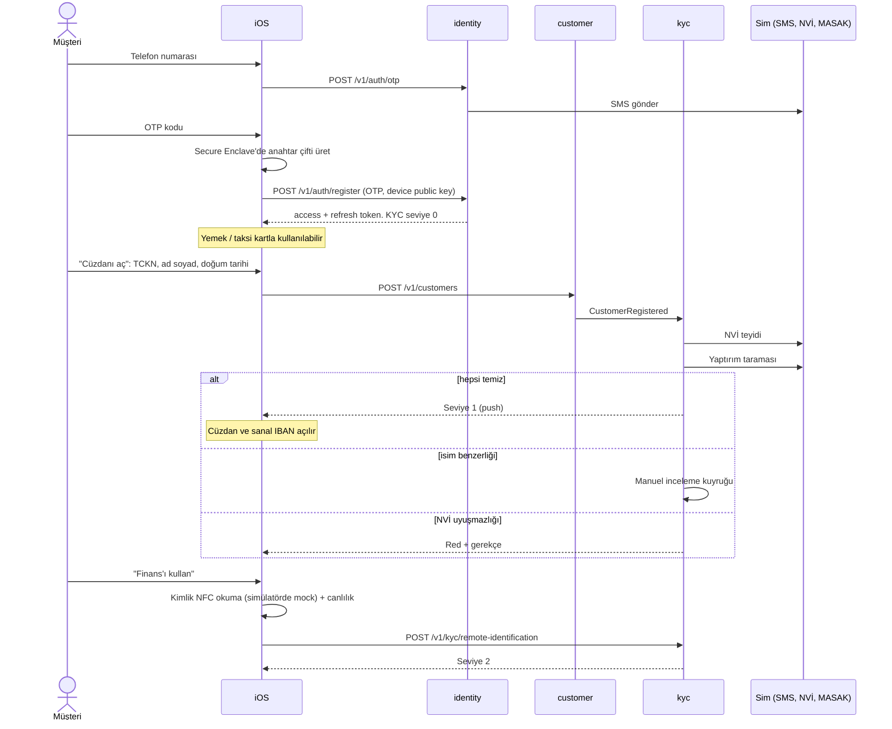
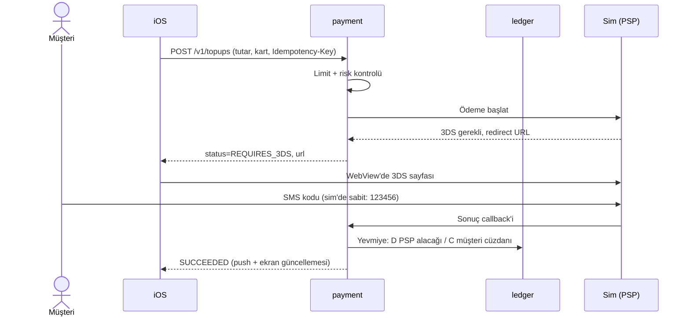
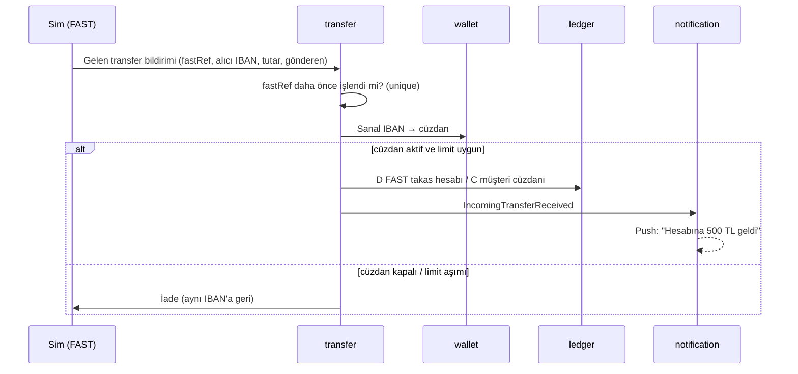
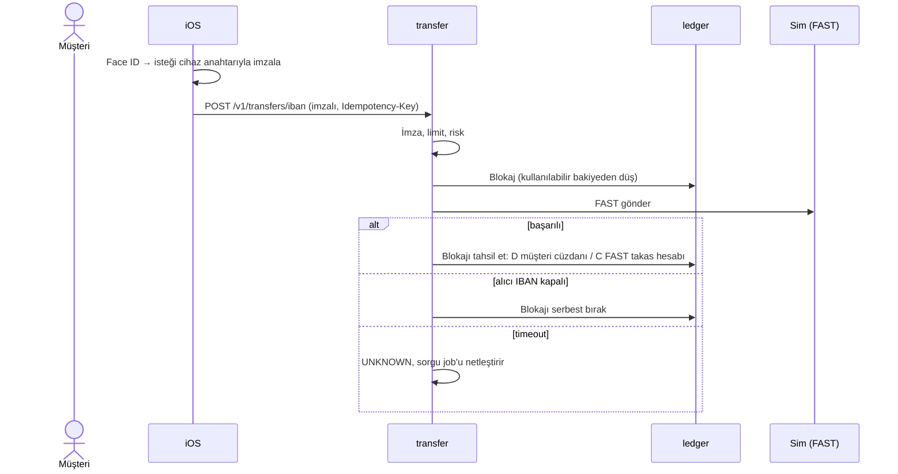
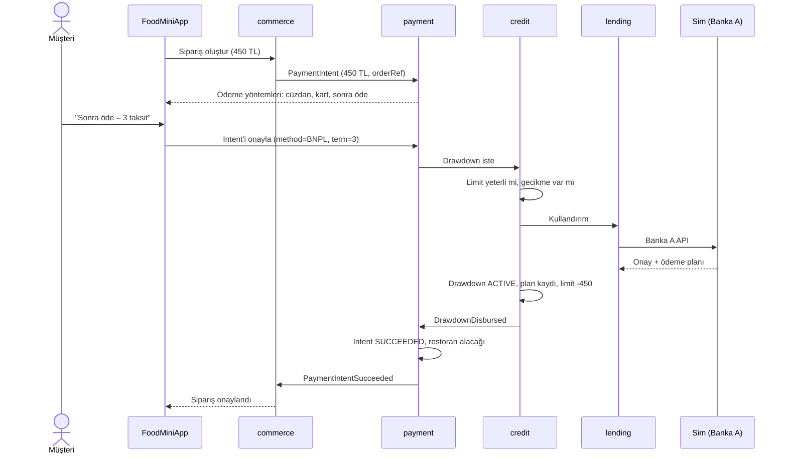
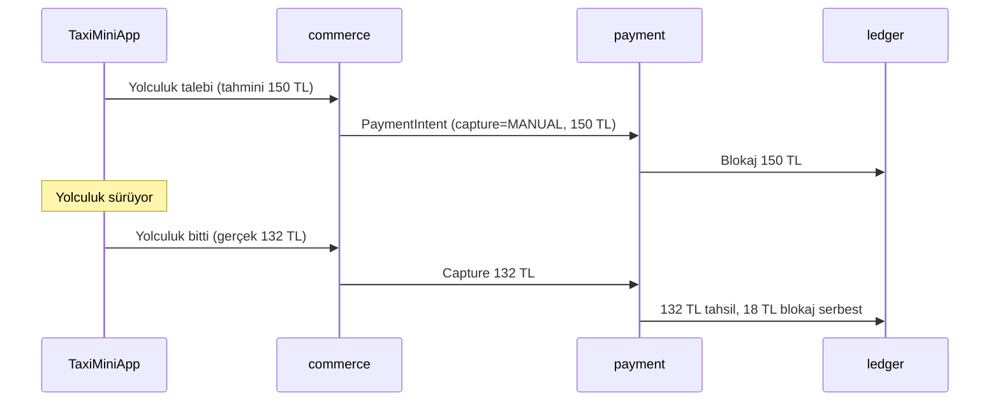
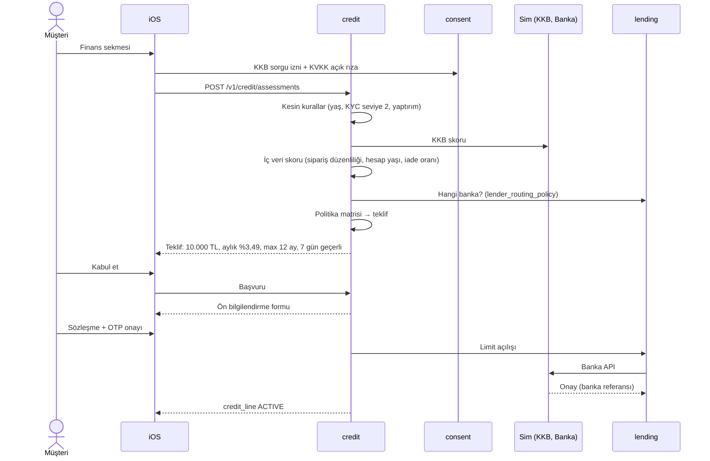
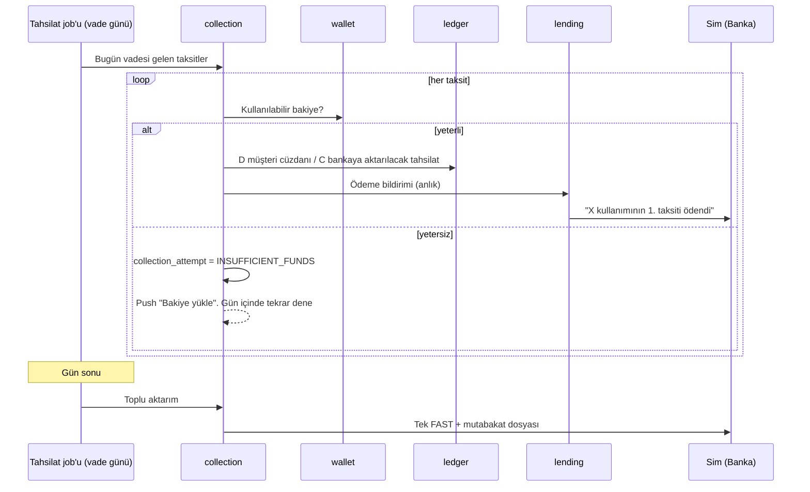
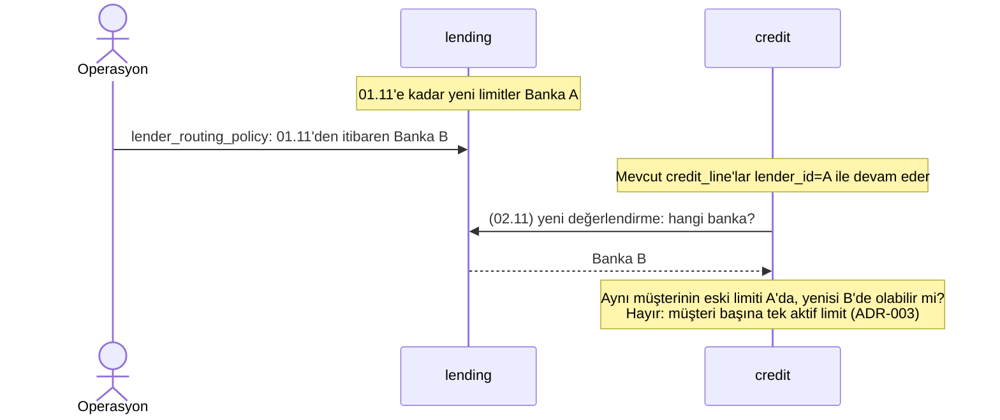

# Uçtan Uca Akışlar

Diyagramlarda `Sim` external-sim'deki ilgili sahte kurumu temsil ediyor.

## 1. Kayıt ve KYC

## 2. Kartla para yükleme (3DS)

Kart sonucu belirsizse (timeout) ödeme `UNKNOWN` olur, bakiye **artmaz**; PSP'ye sorgu atılarak netleştirilir.

## 3. Sanal IBAN'a gelen FAST

## 4. IBAN'a para gönderme (giden FAST)

Para çekme IBAN'a gittiği için geri alınamaz. Bu yüzden önce blokaj, sonuç kesinleşince tahsil.

## 5. Yemek checkout'u ve BNPL

## 6. Taksi: ön provizyon ve tahsil

Gerçek tutar blokajı aşarsa (trafik) fark ayrıca tahsil edilir; bakiye yetmezse kayıtlı karta düşer.

## 7. Kredi değerlendirme ve limit açılışı

## 8. Otomatik tahsilat

Para yüklendiği anda (`WalletCredited`) bekleyen tahsilat varsa hemen denenir; müşteri akşamı beklemez.

## 9. Banka değişimi

