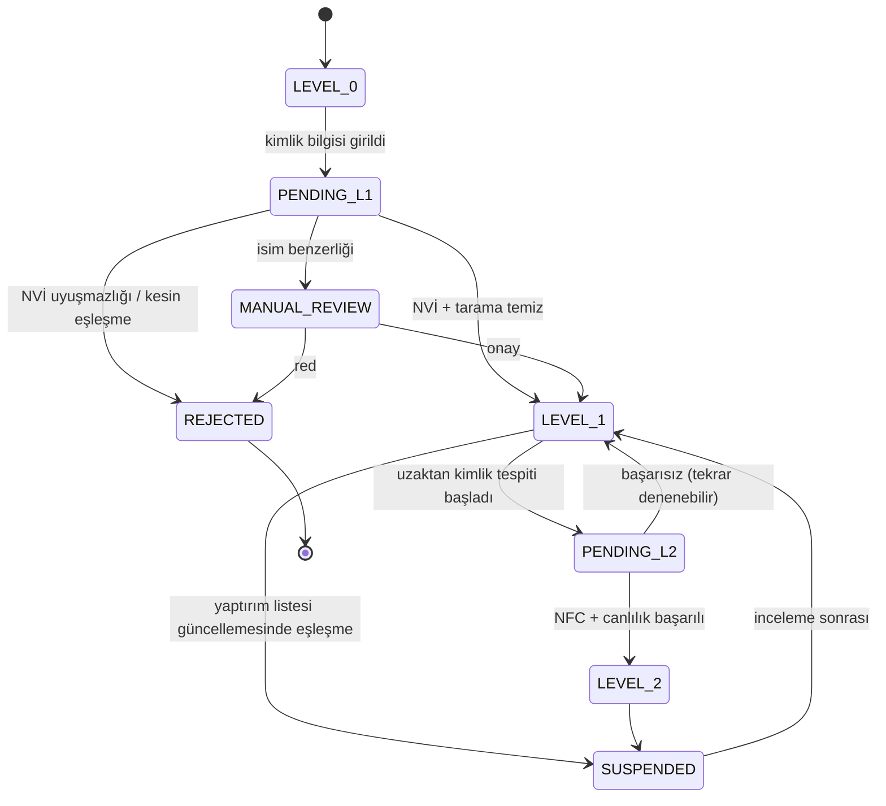
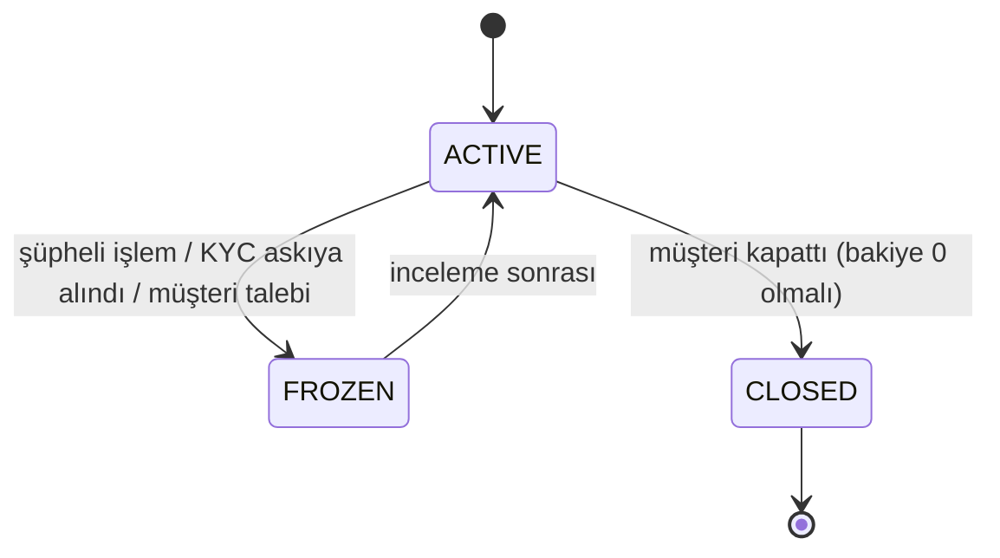
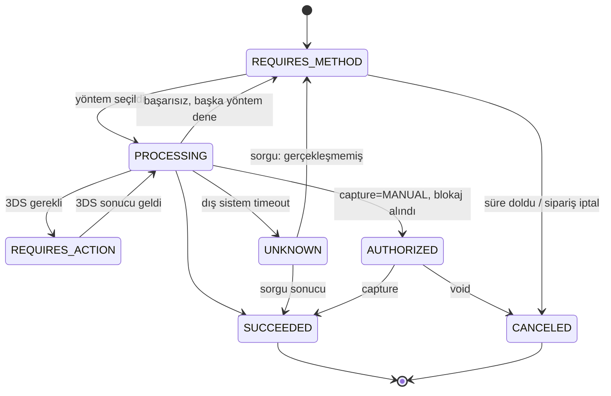
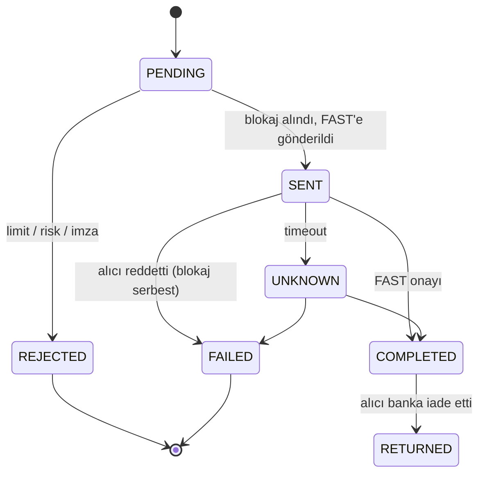
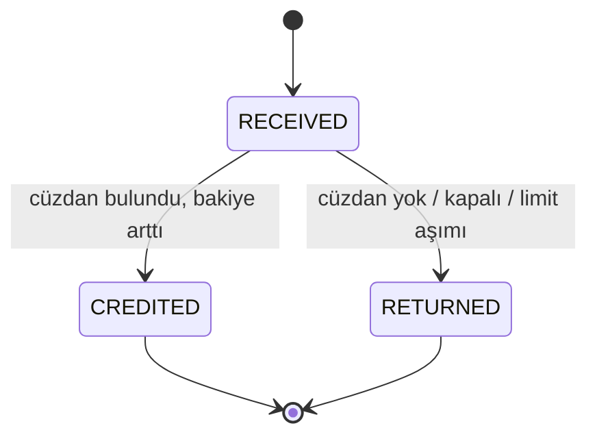
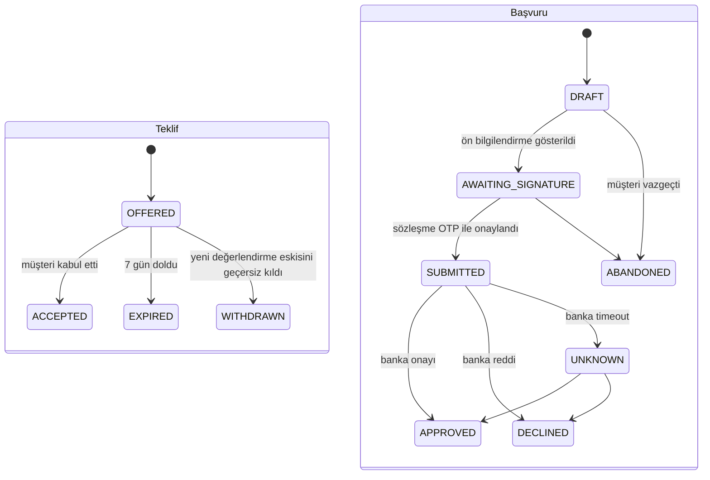
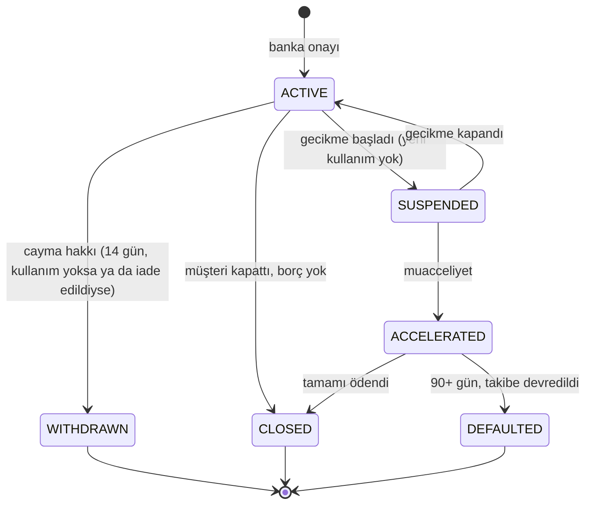
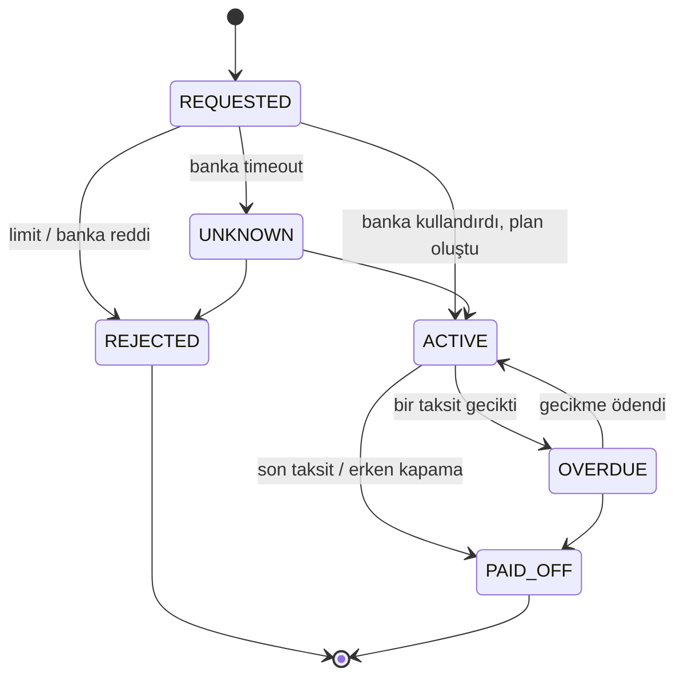
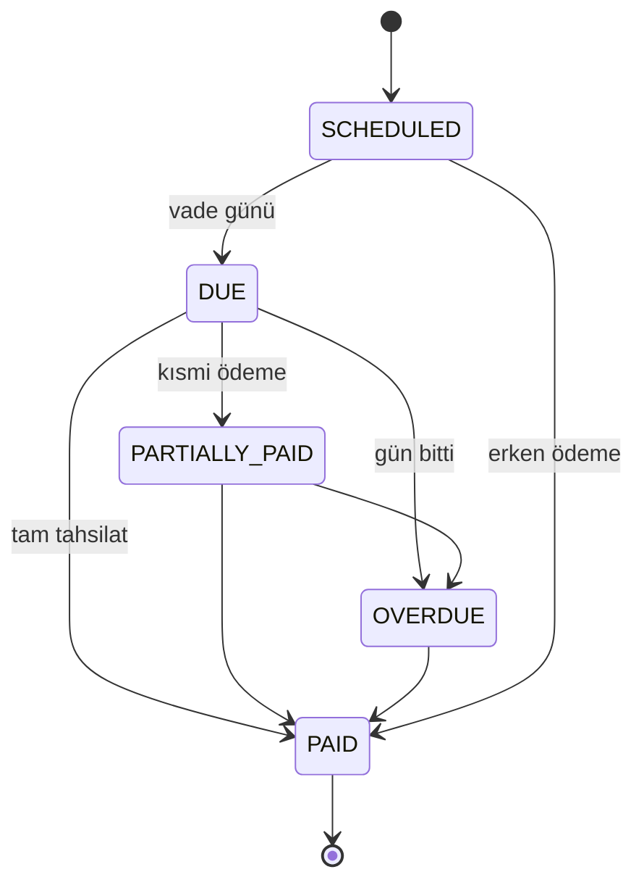

# Durum Makineleri

Her durum bir enum, her geçiş tek bir yerden (`canTransitionTo`) kontrol edilir. Geçersiz geçiş exception'dır;
sessizce yutulmaz. Son durumlar (terminal) bir daha değişmez.

## KYC profili

`REJECTED` müşteri için yeni bir başvuru belirli bir süre engellenir; yanlış veri girişiyle deneme yanılma yapılmasın.

## Cüzdan hesabı

`FROZEN` hesaba para girişi devam eder, çıkışı durur. Gecikmedeki taksit tahsilatı dondurulmuş hesaptan da yapılır.

## Ödeme niyeti (payment intent)

İade, intent'in durumunu değiştirmez; ayrı bir `refund` kaydıdır (kısmi iade birden fazla olabilir).

## Giden transfer (IBAN)

## Gelen transfer

## Kredi teklifi ve başvuru

## Kredi limiti (credit line)

## Kullanım (drawdown)

`UNKNOWN` kullanım limitten **düşülmüş** sayılır. Belirsizken limiti iade etmek, müşterinin aynı limiti iki kez
kullanmasına yol açabilir.

## Taksit

