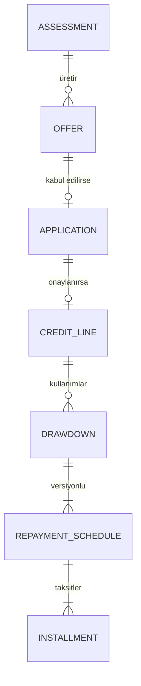

# Veri Modeli

Faz 0 taslağı. Kolonlar ilgili fazda netleşir; burada tabloların varlık sebebi ve ilişkiler önemli.

Ortak kurallar:
- Her modül kendi şemasında. Şemalar arası **foreign key yok**; başka modülün kaydına sadece ID ile referans verilir.
  Modül sınırı DB seviyesinde de korunur, ileride ayrı servise çıkarmak mümkün kalır.
- Tutarlar `BIGINT` kuruş + `currency CHAR(3)`. Oranlar `NUMERIC(9,6)`.
- Zamanlar `TIMESTAMPTZ`, iş tarihleri (vade, değer tarihi) `DATE` ve **İstanbul saatine** göre.
- PII kolonları `_enc` son ekiyle, uygulama katmanında AES-GCM ile şifreli.
- Değiştirilemez tablolar (kararlar, onaylar, yevmiye) için update/delete trigger ile engellenir.
- Durum değişen tablolarda `version` kolonu (optimistic locking).

## identity

| Tablo | Amaç | Önemli kolonlar |
|---|---|---|
| `app_user` | Giriş hesabı | `phone` (unique), `status`, `pin_hash`, `failed_pin_attempts`, `locked_until` |
| `device` | Bağlı cihazlar | `user_id`, `public_key` (P-256), `name`, `bound_at`, `revoked_at` |
| `refresh_token` | Oturum zinciri | `family_id`, `token_hash`, `device_id`, `parent_id`, `expires_at`, `used_at`, `revoked_at` |
| `otp_challenge` | OTP | `phone`, `purpose` (REGISTER, LOGIN, CONTRACT_SIGN), `code_hash`, `attempts`, `expires_at`, `verified_at` |

## customer

| Tablo | Amaç | Önemli kolonlar |
|---|---|---|
| `customer` | Hukuki kişi | `user_id` (unique), `tckn_enc`, `tckn_hash` (unique), `first_name_enc`, `last_name_enc`, `birth_date_enc`, `status` |
| `customer_address` | Adres (seviye 2) | `customer_id`, `type`, `city`, `district`, `line_enc`, `valid_from` |

`app_user` ile `customer` 1-1 ama ayrı. Telefon değişir, müşteri aynı kalır; seviye 0 kullanıcının müşteri kaydı yoktur.

## kyc

| Tablo | Amaç | Önemli kolonlar |
|---|---|---|
| `kyc_profile` | Müşterinin anlık seviyesi | `customer_id`, `level`, `status`, `version` |
| `kyc_check` | Her doğrulama adımı (değiştirilemez) | `customer_id`, `type` (NVI, SCREENING, NFC, LIVENESS), `result`, `provider_ref`, `response_enc`, `checked_at` |
| `review_case` | Manuel inceleme | `customer_id`, `reason`, `status`, `assigned_to`, `decision`, `decided_at` |

## consent

| Tablo | Amaç | Önemli kolonlar |
|---|---|---|
| `consent_document` | Metin ve versiyonu | `type` (KVKK_EXPLICIT, KKB_QUERY, MARKETING, PRE_CONTRACT_INFO, LOAN_CONTRACT), `version`, `content_hash`, `published_at` |
| `consent_record` | Onay (değiştirilemez) | `customer_id`, `document_id`, `action` (GRANTED, REVOKED), `device_id`, `ip`, `occurred_at` |

Geri alma yeni bir satırdır; geçmiş silinmez. "15 Ekim'de KKB izni var mıydı?" sorusu her zaman cevaplanabilir.

## ledger

| Tablo | Amaç | Önemli kolonlar |
|---|---|---|
| `ledger_account` | Hesap planı | `code`, `type` (ASSET, LIABILITY, INCOME, EXPENSE), `owner_type`, `owner_id`, `currency`, `allow_negative` |
| `journal_entry` | Para hareketi | `type`, `reference_type`, `reference_id`, `idempotency_key` (unique), `value_date`, `posted_at`, `reversal_of` |
| `posting` | Satırlar | `entry_id`, `account_id`, `direction` (D/C), `amount` |
| `account_balance` | Bakiye projeksiyonu | `account_id`, `balance`, `held`, `version` |
| `hold` | Blokaj | `account_id`, `amount`, `reference_type`, `reference_id`, `status` (ACTIVE, CAPTURED, RELEASED, EXPIRED), `expires_at` |

`account_balance` postings ile **aynı transaction'da** güncellenir; bakiye için posting toplamı her seferinde
hesaplanmaz. Gece job'u projeksiyonu postings toplamıyla karşılaştırır. Gerekçe: [ADR-002](adr/ADR-002-ledger-tabanli-bakiye.md)

### Hesap planı (örnek)

| Hesap | Tip | Ne zaman hareket eder |
|---|---|---|
| `CUSTOMER_WALLET:{id}` | Yükümlülük | Müşterinin parası. Müşteriye borçluyuz. |
| `SAFEGUARDING_BANK` | Varlık | Müşteri fonlarının tutulduğu korunan banka hesabı |
| `PSP_RECEIVABLE` | Varlık | Kartla yüklemede PSP'den alacağımız (PSP ertesi gün öder) |
| `FAST_CLEARING` | Varlık | FAST giriş/çıkışlarının takas hesabı |
| `MERCHANT_PAYABLE:{id}` | Yükümlülük | Restorana / sürücüye borcumuz |
| `LENDER_DISBURSEMENT:{lender}` | Varlık | Bankanın BNPL / nakit kullanımı için bize göndereceği para |
| `LENDER_COLLECTION_PAYABLE:{lender}` | Yükümlülük | Müşteriden tahsil edip bankaya aktaracağımız taksitler |
| `FEE_INCOME` | Gelir | Komisyonlar |

Örnek: 450 TL BNPL yemek ödemesi

```
D LENDER_DISBURSEMENT:BANK_A      450,00
C MERCHANT_PAYABLE:{restoran}     450,00
```

Örnek: 1. taksit cüzdandan tahsil

```
D CUSTOMER_WALLET:{müşteri}        163,81
C LENDER_COLLECTION_PAYABLE:BANK_A 163,81
```

## wallet

| Tablo | Amaç | Önemli kolonlar |
|---|---|---|
| `wallet_account` | Cüzdan | `customer_id`, `currency`, `ledger_account_id`, `status`, `version` |
| `virtual_iban` | Müşteriye özel IBAN | `iban` (unique), `wallet_account_id`, `assigned_at` |
| `limit_policy` | Seviyeye göre limitler | `kyc_level`, `operation` (TOPUP, P2P_OUT, IBAN_OUT, BALANCE), `period` (DAILY, MONTHLY), `max_amount`, `max_count` |
| `limit_usage` | Dönem sayaçları | `wallet_account_id`, `operation`, `period_start`, `amount`, `count`, `version` |

`limit_usage` sayaç güncellemesi para hareketiyle aynı transaction'dadır; aynı anda gelen iki istek limiti birlikte
aşamaz (optimistic lock çakışmasında tekrar denenir).

## payment

| Tablo | Amaç | Önemli kolonlar |
|---|---|---|
| `payment_intent` | Dikeyin tahsilat isteği | `customer_id`, `vertical`, `order_ref`, `amount`, `capture_method` (AUTOMATIC, MANUAL), `status`, `method`, `idempotency_key` |
| `payment_attempt` | Her yöntem denemesi | `intent_id`, `method`, `status`, `external_ref`, `failure_code` |
| `card_token` | Kayıtlı kart | `customer_id`, `psp_token`, `masked_pan`, `brand`, `expiry`, `status` |
| `topup` | Kartla yükleme | `wallet_account_id`, `card_token_id`, `amount`, `status`, `three_ds_url`, `psp_ref` |
| `refund` | İade | `intent_id`, `amount`, `status`, `reason` |

## transfer

| Tablo | Amaç | Önemli kolonlar |
|---|---|---|
| `transfer` | Giden transfer | `type` (P2P, IBAN), `from_wallet_id`, `to_wallet_id`, `to_iban`, `to_name`, `amount`, `status`, `fast_ref`, `hold_id`, `signature` |
| `incoming_transfer` | Gelen FAST | `fast_ref` (unique), `virtual_iban`, `sender_iban`, `sender_name`, `amount`, `status` |
| `saved_recipient` | Kayıtlı alıcı | `customer_id`, `type`, `iban` / `wallet_id`, `nickname`, `first_used_at` |

## lending

| Tablo | Amaç | Önemli kolonlar |
|---|---|---|
| `lender` | Anlaşmalı banka | `code` (BANK_A, BANK_B), `name`, `status` |
| `lender_product` | Bankanın ürünü | `lender_id`, `type` (CREDIT_LINE), `min_limit`, `max_limit`, `min_rate`, `max_rate`, `max_term`, `status` |
| `lender_routing_policy` | Yeni limitler hangi bankaya | `product_type`, `lender_id`, `valid_from`, `valid_to`, `priority` |
| `lender_call` | Bankaya yapılan her çağrı | `lender_id`, `operation`, `request_ref`, `status`, `duration_ms`, `response_enc` |

## credit



| Tablo | Amaç | Önemli kolonlar |
|---|---|---|
| `assessment` | Karar anı (değiştirilemez) | `customer_id`, `policy_version`, `inputs` (jsonb), `kkb_score`, `internal_score`, `band`, `decision`, `reasons` (jsonb), `created_at` |
| `offer` | Teklif | `assessment_id`, `customer_id`, `lender_product_id`, `limit_amount`, `monthly_rate`, `max_term`, `expires_at`, `status` |
| `application` | Başvuru | `offer_id`, `customer_id`, `lender_id`, `status`, `lender_ref`, `contract_document_id`, `signed_at` |
| `credit_line` | Limit | `customer_id`, `application_id`, `lender_id`, `limit_amount`, `used_amount`, `status`, `lender_ref`, `opened_at`, `withdrawal_deadline`, `version` |
| `drawdown` | Kullanım | `credit_line_id`, `type` (BNPL, CASH), `payment_intent_id`, `principal`, `term`, `monthly_rate`, `status`, `lender_ref`, `idempotency_key` |
| `repayment_schedule` | Ödeme planı | `drawdown_id`, `version`, `active`, `source` (LENDER, RESTRUCTURE) |
| `installment` | Taksit | `schedule_id`, `seq`, `due_date`, `principal`, `interest`, `kkdf`, `bsmv`, `total`, `paid_amount`, `status` |

- **Müşteri başına en fazla bir aktif `credit_line`.** Partial unique index: `UNIQUE (customer_id) WHERE status IN ('ACTIVE','SUSPENDED','ACCELERATED')`.
- `used_amount` her kullanımda artar, her anapara ödemesinde azalır. `available = limit_amount − used_amount`.
- Ödeme planının kaynağı bankadır; bankadan gelen plan kaydedilir, biz kendi hesabımızla **karşılaştırırız** (fark varsa alarm).

## collection

| Tablo | Amaç | Önemli kolonlar |
|---|---|---|
| `autopay_mandate` | Otomatik ödeme talimatı | `credit_line_id`, `wallet_account_id`, `status`, `granted_at`, `revoked_at` |
| `collection_attempt` | Tahsilat denemesi | `installment_id`, `attempt_no`, `scheduled_at`, `executed_at`, `result` (SUCCESS, INSUFFICIENT_FUNDS, WALLET_FROZEN, ERROR), `amount` |
| `repayment` | Gerçekleşen ödeme | `drawdown_id`, `source` (WALLET_AUTOPAY, WALLET_MANUAL, DIRECT_TO_LENDER), `amount`, `received_at`, `value_date`, `idempotency_key` (unique), `lender_ref`, `reported_at` |
| `repayment_allocation` | Waterfall dağılımı | `repayment_id`, `installment_id`, `component` (PENALTY, FEE, TAX, INTEREST, PRINCIPAL), `amount` |
| `delinquency_case` | Gecikme dosyası | `credit_line_id`, `opened_at`, `dpd`, `stage`, `closed_at` |
| `loan_snapshot` | Bankadan gelen son durum | `drawdown_id`, `outstanding_principal`, `accrued_interest`, `penalty`, `dpd`, `as_of`, `source` (WEBHOOK, DAILY_FILE, QUERY) |

Taksit tahsilatının idempotency key'i `installment:{id}:attempt-day:{tarih}`. Aynı gün job iki kez çalışsa da
ikinci tahsilat unique constraint'te durur.

## reconciliation

| Tablo | Amaç | Önemli kolonlar |
|---|---|---|
| `settlement_batch` | Bankaya toplu aktarım | `lender_id`, `business_date`, `total_amount`, `item_count`, `status`, `transfer_ref` |
| `settlement_item` | Aktarımdaki ödemeler | `batch_id`, `repayment_id`, `amount` |
| `recon_run` | Mutabakat çalışması | `type` (LENDER_BALANCE, COLLECTION_3WAY, LEDGER_PROJECTION), `business_date`, `status`, `matched`, `mismatched` |
| `recon_item` | Fark | `run_id`, `reference`, `ours`, `theirs`, `result` |

## commerce

| Tablo | Amaç |
|---|---|
| `restaurant`, `menu_item` | Sahte yemek kataloğu (seed) |
| `food_order` | Sipariş: `customer_id`, `restaurant_id`, `amount`, `payment_intent_id`, `status` |
| `ride` | Yolculuk: `customer_id`, `estimated_amount`, `final_amount`, `payment_intent_id`, `status` |

Sipariş geçmişi kredi değerlendirmesinde iç veri olarak kullanılır; sadece KVKK açık rızası varsa (`consent` kontrolü).

## risk, notification

| Tablo | Amaç |
|---|---|
| `risk_rule` | Kural tanımı: `code`, `operation`, `parameters` (jsonb), `action` (ALLOW, STEP_UP, REVIEW, DENY), `active` |
| `risk_decision` | Her değerlendirme: `operation`, `reference_id`, `matched_rules`, `action` |
| `notification` | Gönderim: `customer_id`, `channel` (PUSH, SMS, IN_APP), `template`, `payload`, `status`, `sent_at`, `read_at` |
| `push_token` | APNs token: `device_id`, `token`, `updated_at` |
