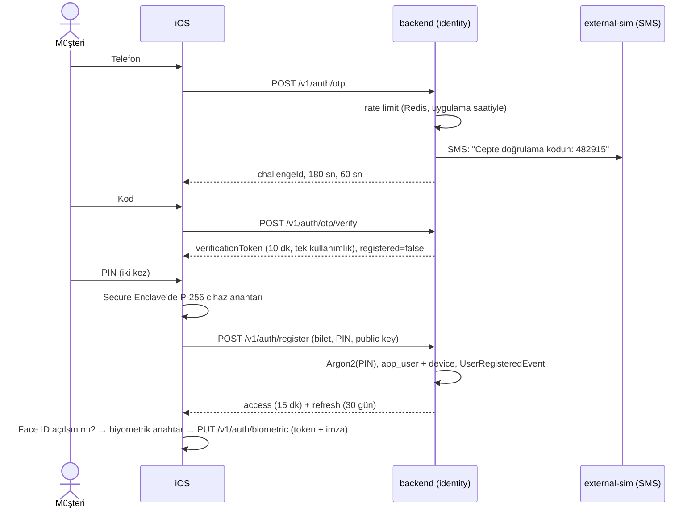

# Kimlik ve Oturum

CP-2'de yazılan kısım: telefonla kayıt, cihaz bağlama, PIN, Face ID, oturum yenileme. Kararların gerekçesi
[ADR-006](adr/ADR-006-cihaz-bagli-oturum.md).

## 1. Neye karşı korunuyoruz

| Saldırı | Örnek | Önlem |
|---|---|---|
| SIM kopyalama | Dolandırıcı operatörden kurbanın numarasına SIM çıkarır, OTP'ler ona gelir | Yeni cihaz bağlamak için OTP + **PIN** gerekir; eski cihaza bildirim gider (CP-5'te push) |
| Token çalınması | Log, proxy ya da kötü amaçlı yazılım refresh token'ı ele geçirir | Refresh isteği **cihaz anahtarıyla imzalı** olmalı; token tek kullanımlık, tekrar kullanılırsa tüm aile kapanır |
| Telefonun çalınması | Kilidi açık telefon başkasının elinde | Uygulama 5 dakikadan uzun arka planda kalınca kilitlenir; açmak için PIN ya da Face ID |
| OTP tahmini | 6 haneli kodun 10⁶ ihtimali | Kod başına 5 deneme, 3 dakika ömür; kod veritabanında HMAC'li |
| SMS pompalama | Bot binlerce numaraya kod istetir, SMS faturası şişer | Numara başına 60 sn bekleme ve 10 dakikada 3 kod; IP başına 10 kod |
| Numara taraması | "Bu numara müşteri mi?" sorusu | OTP doğrulanana kadar kayıtlı / kayıtsız numaraya aynı cevap |

## 2. Akışlar

### Kayıt



### Kayıtlı kullanıcı yeni cihazda

OTP aynı. `registered=true` döner; uygulama PIN ister ve `POST /v1/auth/devices` çağırır. Backend PIN'i doğrular,
eski cihazı `REVOKED` yapar, eski cihazın tüm refresh token'larını kapatır ve `DeviceBoundEvent` yayınlar. Eski cihazın
elindeki access token'ı da süresini beklemeden geçersiz olur (`DeviceRevocationValidator`).

### Uygulama açılışı

```
Keychain'de oturum bilgisi var mı?
  ├─ yok  → onboarding
  └─ var  → kilit ekranı
              ├─ Face ID açıksa hemen sorulur → POST /v1/auth/login/biometric (cihaz + biyometrik imza)
              └─ PIN → POST /v1/auth/login (cihaz imzalı)
```

Kilit ekranı yerel bir kilit değil: PIN cihazda saklanmadığı için doğrulama her zaman backend'de yapılır.

## 3. İstek imzası

Giriş, yenileme ve (sonraki fazlarda) para çıkışı yapan istekler imzalanır:

```
X-Device-Id:   7
X-Timestamp:   1792400400            ← sunucu saatiyle, ±5 dk
X-Nonce:       2C5E...               ← 10 dk içinde bir kez (Redis)
X-Signature:   Base64(ECDSA-P256(SHA-256( METHOD \n PATH \n TIMESTAMP \n NONCE \n hex(SHA-256(body)) )))
```

payment-switch'teki terminal HMAC imzasıyla aynı yapı, tek fark anahtarın asimetrik olması. Backend'de sadece public key
var; veritabanı sızsa bile kimse cihaz adına imza atamaz.

Biyometrik girişte aynı metin ikinci bir anahtarla da imzalanır (`X-Biometric-Signature`). İki anahtar olmasının sebebi:
cihaz anahtarı her token yenilemede arka planda kullanılır ve Face ID soramaz, biyometrik anahtar ise sadece Face ID ile açılır.

**Zaman damgası neden sunucu saatiyle?** Simülasyonda backend'in saati 31 gün ileride olabilir. Cihaz kendi saatiyle
imzalasaydı her istek "zaman damgası geçersiz" alırdı. iOS'taki `ServerClock`, konfigürasyon cevabındaki `serverTime` ile
farkı hesaplar; imza ve ekrandaki tarihler bu saatten alınır.

## 4. Oturum ve refresh token rotation

```
login ──► aile F1: R1 ──(refresh)──► R2 ──(refresh)──► R3
                    │ used           │ used
                    ▼                ▼
          R1 tekrar gelirse: F1'in tamamı iptal (REUSE_DETECTED), R3 de geçersiz
```

- Refresh token 256 bit rastgele, veritabanında SHA-256 hash'i durur.
- Her yenilemede eski token `used_at` alır, aynı ailede yenisi üretilir.
- Kullanılmış token tekrar gelirse token kopyalanmıştır: iki tarafı da çıkışa düşürmek, saldırganı içeride bırakmaktan iyidir.
- Token başka bir cihazın imzasıyla gelirse aile yine kapatılır (`DEVICE_MISMATCH`).
- Cihazda tek oturum: yeni giriş, aynı cihazdaki eski aileleri kapatır.

## 5. PIN

- Argon2id. 6 haneli PIN'in sadece 10⁶ ihtimali olduğu için hash'in yavaş ve bellek yoğun olması kritik.
- 111111, 123456, 654321, 121212, 123123 gibi PIN'ler reddedilir (backend ve iOS'ta aynı kural).
- 5 yanlış denemede kilit: ilk seferde 30 dk, sonraki her kilitte iki katı, en fazla 24 saat. Kilit sayısı sıfırlanmaz.
- Yanlış denemeler `REQUIRES_NEW` transaction'da sayılır; çağıran işlem geri alınsa da sayaç artar.

## 6. Zaman ve Redis

OTP sayaçları Redis'te ama pencere hesabı **uygulama saatiyle** yapılır (`otp:count:phone:{tel}:{pencere no}`).
Redis TTL'i Redis'in kendi saatiyle işler; simülasyonda zaman ileri sarıldığında TTL dolmazdı ve kullanıcı saatlerce
kod isteyemezdi. TTL sadece temizlik için. Redis'e ulaşılamazsa aynı limitler `otp_challenge` tablosundan sayılır:
SMS limiti fail-open olmaz, çünkü açık kalırsa saldırganın faturası bize kesilir.

Access token doğrulaması da `Clock` bean'iyle yapılır. Nimbus'ın kendi süre kontrolü sistem saatine baktığı için
kapatıldı; aksi halde simülasyonda 15 dakikası dolan token geçerli görünürdü.

## 7. iOS tarafı

| Parça | Dosya | Java karşılığı |
|---|---|---|
| Keychain | `Core/Sources/DeviceSecurity/KeychainStore.swift` | Şifreli, cihaza bağlı bir anahtar-değer deposu |
| Cihaz anahtarı | `DeviceKeyStore.swift` | `KeyStore` ama özel anahtar çipten hiç çıkmaz |
| Face ID | `BiometricAuthenticator.swift` | - |
| İmza | `RequestSigner.swift` | Backend'deki `DeviceSignature` ile birebir |
| Tek seferlik yenileme | `Core/Sources/SessionKit/SessionManager.swift` | `synchronized` + paylaşılan `CompletableFuture` |
| Token ekleyen istemci | `AuthenticatedHTTPClient.swift` | `ClientHttpRequestInterceptor` |
| Oturum durumu | `SessionStore.swift` | Uygulamanın hangi ekranı göstereceğine karar veren state |
| Ekranlar | `Features/Sources/AuthFlow/` | - |

**`actor` neden?** Ekran açılırken 5 istek aynı anda 401 alırsa 5 ayrı yenileme yapılmamalı; ilki token'ı döndürür, diğer
4'ü "kullanılmış token" sayılır ve backend oturumu kapatır. `SessionManager` bir actor: içindeki değişkenlere aynı anda tek
çağrı erişir. İlk çağrı yenileme görevini (`Task`) başlatır, diğerleri aynı görevin sonucunu bekler. Testi:
`SessionManagerTests.eszamanli401lerTekYenilemeYapar`.

**Simülatör notları**

- Apple Silicon Mac'te simülatör Secure Enclave anahtarı üretebiliyor, ama anahtara "sadece Face ID ile aç"
  (`biometryCurrentSet`) kuralı koymayı desteklemiyor. Simülatörde biyometrik anahtar bu kural olmadan üretilir, Face ID
  kontrolünü uygulama `LAContext` ile yapar. Gerçek cihazda kural çipin kendisinde.
- Face ID: Features > Face ID > Enrolled, sonra Matching Face. Komut satırından:

```bash
xcrun simctl spawn booted notifyutil -s com.apple.BiometricKit.enrollmentChanged 1
xcrun simctl spawn booted notifyutil -p com.apple.BiometricKit.enrollmentChanged
xcrun simctl spawn booted notifyutil -p com.apple.BiometricKit_Sim.pearl.match
```

- OTP: kod ekranında Debug build'de "Simülatörden kodu al" butonu var; geliştirici menüsünde de SMS kutusu görünür.
